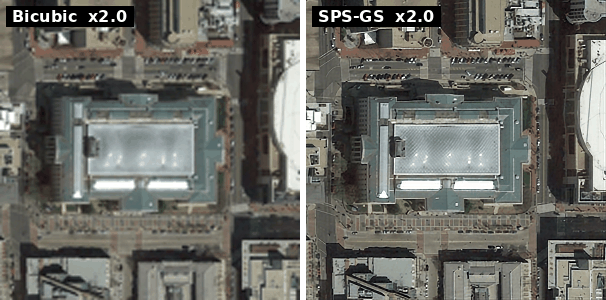
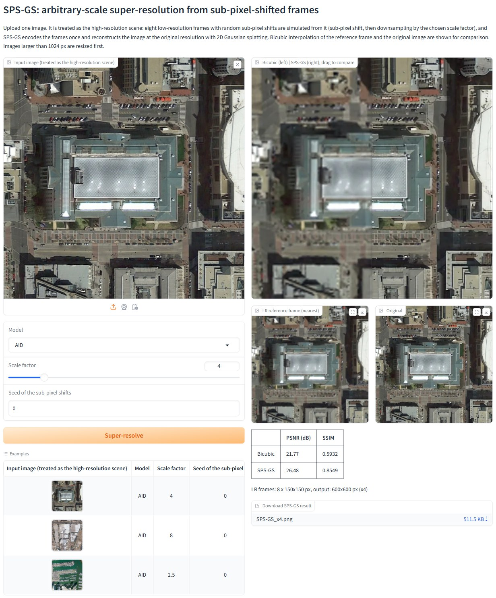

# SPS-GS

**You Only Encode Once: Sub-Pixel-Shifted Frames for Arbitrary-Scale Remote Sensing Super-Resolution with 2D Gaussian Splatting**

<p align="center">
  
</p>
<p align="center"><sub>Continuous zoom from ×2 to ×8 on the same eight LR frames, simulated from an AID image at 1/4 resolution.
Left: bicubic interpolation of the reference frame. Right: SPS-GS.</sub></p>

SPS-GS (**S**ub-**P**ixel-**S**hifted **G**aussian **S**platting) reconstructs a remote sensing image at an arbitrary
scale factor from several low-resolution (LR) observations of the same scene that differ by sub-pixel shifts.
Phase-Coherent Aliasing Demodulation (PCAD) aligns the observations in the Fourier domain and estimates their aliased
components, so that all observations are fused before a single pass of the deep encoder. Gaussian Projection Alignment
(GPA) then refines the centers and colors of the 2D Gaussians by back-projecting the residuals of all observations, and
the Gaussians are rendered at the requested resolution.

This repository provides the inference code, a web demo and the pretrained models.

## Simulation mode

The models are trained and evaluated on LR observations synthesized from single high-resolution (HR) images. All scripts
therefore take **one image** as input and treat it as the HR scene:

1. the image is cropped to a multiple of the scale factor *s*;
2. eight LR frames are synthesized: the HR image is shifted by a random sub-pixel offset (frame 0 is not shifted, the
   other offsets are drawn uniformly from [0, *s*) HR pixels in x and y) and then downsampled by *s* (bicubic, 8-bit);
3. SPS-GS reconstructs the image at its original resolution from the eight frames and their shifts;
4. PSNR and SSIM are computed against the input image (PSNR on RGB, SSIM on the Y channel, a border of ⌈*s*⌉ pixels
   is excluded).

The offsets are drawn from a fixed seed (`--seed`, default 0), so the frames are reproducible and the numbers match the
paper. The models are trained with scale factors in [1, 4]; larger factors (e.g. ×8, ×16) are extrapolation. Non-integer
scale factors are supported.

## Installation

Clone this repository, enter it and install the dependencies (tested with Python 3.9, PyTorch 1.13 and CUDA 11.7):

```bash
cd SPS-GS
conda create -n spsgs python=3.9 -y
conda activate spsgs
pip install torch==1.13.0+cu117 torchvision==0.14.0+cu117 --extra-index-url https://download.pytorch.org/whl/cu117
pip install -r requirements.txt
```

The Gaussian rasterizer is written in plain PyTorch (`spsgs/render.py`), so no CUDA extension has to be compiled. A GPU
is recommended; without one, the code falls back to the CPU (about 12 s for a 600×600 image at ×4 with 8 threads).

## Pretrained models

Download the weights from the Releases page of this repository and put them into `weights/`:

| `--model` | Training set | File |
|---|---|---|
| `aid` (default) | AID | `weights/SPS-GS_AID.pth` |
| `ucmerced` | UCMerced | `weights/SPS-GS_UCMerced.pth` |
| `whu-rs19` | WHU-RS19 | `weights/SPS-GS_WHU-RS19.pth` |
| `rsscn7` | RSSCN7 | `weights/SPS-GS_RSSCN7.pth` |
| `nwpu-resisc45` | NWPU-RESISC45 | `weights/SPS-GS_NWPU-RESISC45.pth` |
| `div2k` | DIV2K (natural images) | `weights/SPS-GS_DIV2K.pth` |

`--model` also accepts the path of a `.pth` file. All commands below are run from the root of the repository.

## Usage

### Command line

```bash
python inference.py -i assets/examples -s 4
```

Each image is saved as `results/<name>_x4_SPS-GS.png`, and PSNR / SSIM of bicubic interpolation and SPS-GS are printed.
Several scale factors, another model and all intermediate images:

```bash
python inference.py -i assets/examples/center_246.jpg -o results -m aid -s 2 3.5 8 --save-all
```

| Option | Meaning |
|---|---|
| `-i`, `--input` | image file or folder (default `assets/examples`) |
| `-o`, `--output` | output folder (default `results`) |
| `-m`, `--model` | model name or weight file (default `aid`) |
| `-s`, `--scale` | one or more scale factors (default `4`) |
| `--seed` | seed of the sub-pixel shifts (default `0`) |
| `--save-all` | also save the cropped original, the bicubic result and the eight LR frames |
| `--tile` | LR inputs with more pixels than this are processed in overlapping tiles at integer scales (default `360000`, `0` disables) |
| `--device` | `cuda` (default) or `cpu` |

### Web demo

```bash
python app.py
```

Open http://127.0.0.1:7860 in a browser, upload an image or pick an example, choose the model, the scale factor and the
seed, and press **Super-resolve**. The result is compared with bicubic interpolation in a before/after slider; the LR
reference frame, the original image, PSNR / SSIM and a download link are shown below. Images larger than 1024 pixels
are resized first. Use `--share` for a public Gradio link, or `--host 0.0.0.0 --port 7860` to serve on the local network.

<p align="center">
  
</p>

### Zoom GIF

```bash
python make_gif.py -i assets/examples/center_246.jpg -o results/demo.gif
```

This reproduces `assets/demo.gif`: the eight LR frames are simulated once (`--base 4`), and SPS-GS renders them at
scale factors from ×2 to `--max-scale` (default 8) next to bicubic interpolation. `--center x y` (in [0, 1]) sets the
zoom center, `--size` the panel size, `--steps` and `--duration` the number of frames and the time per frame in ms.

### Python

```python
from spsgs import load_image, load_model, setup, super_resolve, to_pil

device = setup('cuda')
model = load_model('aid', device)
hr = load_image('assets/examples/center_246.jpg', device)
out = super_resolve(model, hr, scale=4, seed=0)
to_pil(out['sr']).save('center_246_x4_SPS-GS.png')
print(out['metrics'])
```

`out` holds the cropped input (`hr`), the reference LR frame (`lr`), all LR frames (`frames`, 1×8×3×h×w), their shifts
(`shifts`), the bicubic result (`bicubic`), the SPS-GS result (`sr`) and the PSNR / SSIM of both (`metrics`).

### Evaluation

The test lists of the paper are in `splits/` (image paths relative to the dataset root). With the datasets downloaded to
`datasets/`:

```bash
python evaluate.py -i datasets/AID -l splits/AID_test.txt -m aid -s 2 4 8 16
python evaluate.py -i datasets/UCMerced_LandUse/Images -l splits/UCMerced_test.txt -m ucmerced -s 2 4 8 16
python evaluate.py -i datasets/NWPU-RESISC45 -l splits/NWPU-RESISC45_test.txt -m nwpu-resisc45 -s 2 4 8 16
```

Without `-l`, all images under `-i` are evaluated; `--save` writes the outputs to a folder. PSNR (dB, RGB) of SPS-GS
reported in the paper, where every dataset has its own training and test sets:

| Dataset | ×2 | ×4 | ×8 | ×16 |
|---|---|---|---|---|
| AID | 40.60 | 32.72 | 27.52 | 24.40 |
| UCMerced | 40.02 | 31.78 | 26.15 | 22.60 |
| WHU-RS19 | 42.30 | 33.22 | 27.43 | 24.01 |
| RSSCN7 | 37.94 | 30.13 | 26.32 | 23.90 |
| NWPU-RESISC45 | 38.77 | 31.03 | 26.45 | 23.59 |

Test lists are provided for AID, UCMerced and NWPU-RESISC45.

## Notes

- TF32 is disabled (`spsgs.setup`) so that the results match the paper.
- `spsgs/render.py` is a tile-based 2D Gaussian sum rasterizer (3σ tile culling, contributions below 1/255 are
  dropped, every Gaussian of a tile is accumulated). It reproduces the CUDA rasterizer used for the paper up to
  floating-point rounding.
- Only the simulation mode is covered. Real multi-frame data would first have to be registered to sub-pixel accuracy;
  `spsgs.utils.run(model, frames, scale, shifts)` takes the frames (1×8×3×h×w, frame 0 is the reference) and, for each
  frame, its offset (dx, dy) relative to frame 0 in units of 1/4 LR pixel, where frame k samples the scene at positions
  shifted by +(dx, dy).

## License and acknowledgements

This project is released under the [CC BY-NC 4.0](LICENSE) license for non-commercial use. Parts of the code are adapted,
with modifications, from [ContinuousSR](https://github.com/peylnog/ContinuousSR) (CC BY-NC 4.0). `spsgs/swinir.py` is
adapted from [SwinIR](https://github.com/JingyunLiang/SwinIR) (Apache-2.0, see [LICENSE-SwinIR](LICENSE-SwinIR)). The
rasterizer follows the 2D Gaussian splatting of [GaussianImage](https://github.com/Xinjie-Q/GaussianImage) and
[gsplat](https://github.com/nerfstudio-project/gsplat). We thank the authors of these projects.
